<div align="center">

# 🧠 Brain Bleed Detection on CT

### 2.5D EfficientNet-B2 + Bidirectional GRU for multi-label intracranial hemorrhage detection

*Author: **Azizul Abedin Azmi***

[](https://www.python.org/)
[](https://pytorch.org/)
[](https://github.com/huggingface/pytorch-image-models)
[](https://www.kaggle.com/competitions/rsna-intracranial-hemorrhage-detection)
[](LICENSE)
[](LICENSE-docs)
[](https://huggingface.co/azizulabedinazmi/rsna-ich-efficientnet-b2-2.5d)
[](#16-portfolio-project-and-disclaimer)
[](https://orcid.org/0009-0003-5269-6900)

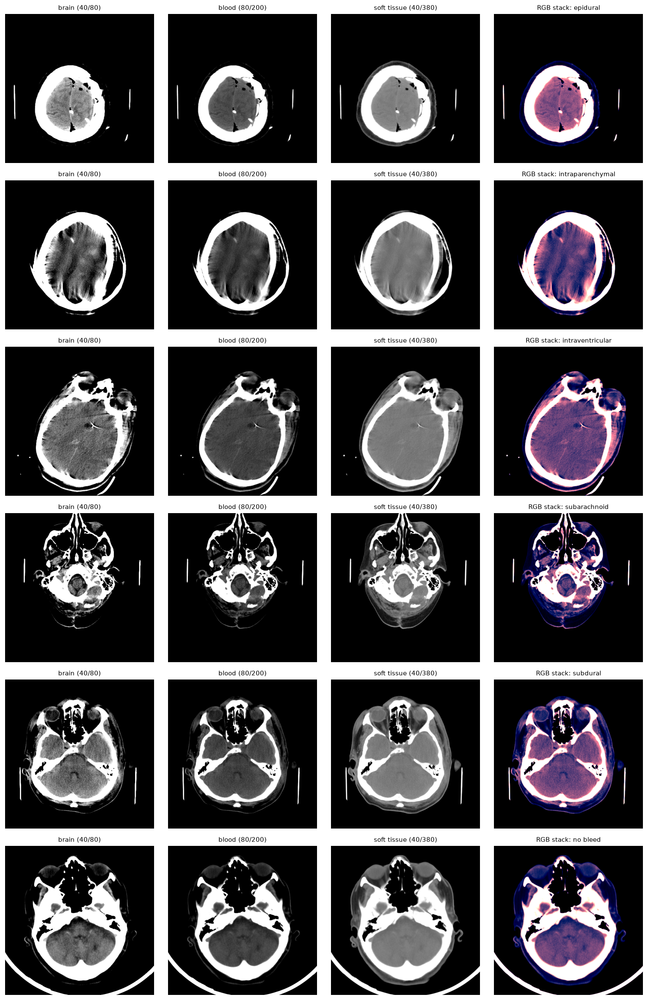

<sub>One slice per hemorrhage subtype in the three CT windows the model sees, plus the RGB stack of the three.</sub>

</div>

---

## Abstract

Intracranial hemorrhage is a medical emergency, and on CT it can be small, subtle, or several types at once.
This project trains a **multi-label** classifier on the [RSNA Intracranial Hemorrhage Detection](https://www.kaggle.com/competitions/rsna-intracranial-hemorrhage-detection)
dataset that outputs six independent probabilities per CT slice: **any** bleed plus **epidural, intraparenchymal, intraventricular,
subarachnoid** and **subdural**. Each slice is given to an **EfficientNet-B2** together with its two neighbours, every slice rendered in
three CT windows (**9 input channels**, "2.5D"). A bidirectional **GRU** over each whole series is then trained as an optional second stage
and kept only if it beats the CNN.

Trained on 149,976 slices (4,337 whole series) for 5 epochs, the CNN reaches a **competition-weighted log loss of 0.0970** and
**AUC(any) = 0.964** on a held-out, patient-level validation split (0.0933 / 0.968 in an earlier Kaggle run with the same split), and
beats a predict-the-prevalence baseline on all six outputs. On the official stage-2 test set, the Kaggle **private score is
0.08346**. The full pipeline, from DICOM to `submission.csv`, runs in about
**one hour on a laptop RTX 4060** once the DICOM headers have been scanned.

<div align="center">

| Kaggle private score ↓ | Val weighted log loss ↓ | AUC (any) ↑ | Best AUC | Hardest subtype | Training slices | End-to-end (local) |
|:---:|:---:|:---:|:---:|:---:|:---:|:---:|
| **0.08346** | **0.0970** | **0.964** | **0.990** intraventricular | epidural (AUC 0.937) | **149,976** | **≈ 62 min** |

</div>

> [!NOTE]
> **Personal portfolio project.** Built for learning and to demonstrate my work; submitted to Kaggle as a late submission
> after the competition closed. Not affiliated with or endorsed by RSNA or Kaggle, and **not a medical device**.
> The trained weights are available on Hugging Face **on request**. See
> [Portfolio project and disclaimer](#16-portfolio-project-and-disclaimer).

## Table of contents

1. [Introduction](#1-introduction)
2. [Dataset](#2-dataset)
3. [Method](#3-method)
4. [Experimental setup](#4-experimental-setup)
5. [Results](#5-results)
6. [Qualitative analysis](#6-qualitative-analysis)
7. [Discussion](#7-discussion)
8. [Problems I hit and how I fixed them](#8-problems-i-hit-and-how-i-fixed-them)
9. [Reproducing the results](#9-reproducing-the-results)
10. [Submitting to the Kaggle competition](#10-submitting-to-the-kaggle-competition)
11. [Configuration](#11-configuration)
12. [Project structure](#12-project-structure)
13. [Limitations and future work](#13-limitations-and-future-work)
14. [Citation](#14-citation)
15. [License](#15-license)
16. [Portfolio project and disclaimer](#16-portfolio-project-and-disclaimer)

---

## 1. Introduction

**Problem.** Given one axial head-CT slice (and its series), predict the probability of each of five hemorrhage subtypes and of *any*
hemorrhage. One slice can contain several subtypes at the same time (for example subdural *and* subarachnoid), so this is a
**multi-label** task: six sigmoid outputs trained with binary cross-entropy, not a softmax.

**Why it is hard.**
- **Heavy class imbalance**: only 14.3% of slices contain any bleed and only 0.42% an epidural one. A model that always says "no bleed"
  is 85.7% *accurate* on `any`, so accuracy is useless here; the project reports **log loss and AUC per output**.
- **3D context matters**: a bleed usually spans neighbouring slices, while noise and bone artefacts often appear on only one.
- **Raw CT values** are Hounsfield units (HU) spanning roughly −1000 to +3000; blood differs from brain by only a few tens of HU.

**Contributions of this notebook.**
- Whole-series sampling from a one-pass DICOM header scan, so every training slice has its real neighbours.
- A compact, exact **int16 HU cache** with CT windowing done on the GPU.
- A **9-channel 2.5D** EfficientNet-B2 with a **patient-level** train/validation split (asserted leak-free).
- An optional **series-level GRU** that is kept only when it improves out-of-fold log loss.
- Full evaluation: per-output log loss and AUC against a baseline, ROC, calibration, error examples and **Grad-CAM**.
- A crash-safe **multi-GPU** path for Kaggle's T4 x2 and a competition-ready `submission.csv`.

## 2. Dataset

[RSNA Intracranial Hemorrhage Detection](https://www.kaggle.com/competitions/rsna-intracranial-hemorrhage-detection/data) (stage 2):
over 25,000 head-CT exams from four institutions, labelled by more than 60 volunteer expert radiologists. Each slice is one DICOM file.

`stage_2_train.csv` has 4,516,842 rows (one per *image × subtype*, 24 exact duplicates) → **752,802 labelled slices**.

| Subtype | Positive slices | Rate |
|---|---:|---:|
| epidural | 3,145 | 0.418% |
| intraventricular | 26,205 | 3.481% |
| subarachnoid | 35,675 | 4.739% |
| intraparenchymal | 36,118 | 4.798% |
| subdural | 47,166 | 6.265% |
| **any** | **107,933** | **14.338%** |

<p align="center">
  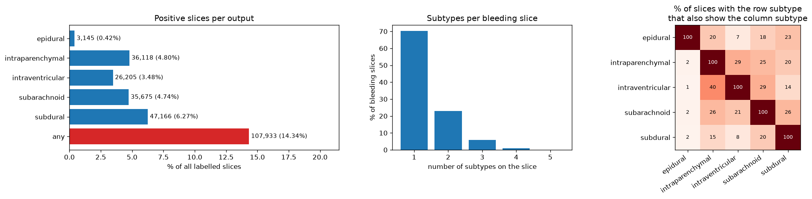
</p>
<p align="center"><sub><b>Figure 1.</b> Label distribution: positives per output, subtypes per bleeding slice, and how often subtypes co-occur.</sub></p>

The header scan finds **21,744 series from 18,938 patients** (median 33 slices per series, max 60).

<p align="center">
  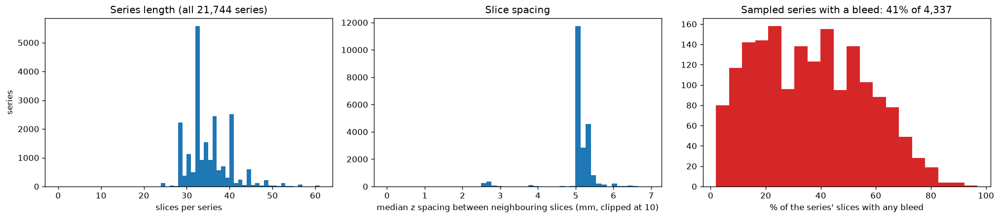
</p>
<p align="center"><sub><b>Figure 2.</b> Series statistics: slices per series, slice spacing along z, and the share of bleeding slices per series.</sub></p>

<p align="center">
  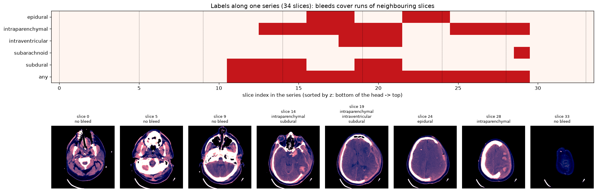
</p>
<p align="center"><sub><b>Figure 3.</b> Labels along one whole series (z order), with evenly spaced thumbnails. Bleeds form runs of neighbouring slices.</sub></p>

## 3. Method

### 3.1 Pipeline

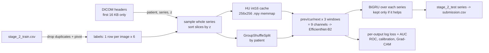

### 3.2 Labels

`ID` values look like `ID_<image>_<subtype>`. They are split with `rsplit("_", n=1)`, duplicate *(image, subtype)* rows are dropped,
and the table is pivoted to six `uint8` columns. One known-corrupt training DICOM (`ID_6431af929`) is removed.

### 3.3 Hounsfield units and CT windows

`HU = pixel × RescaleSlope + RescaleIntercept`. Some scans store 12-bit unsigned values with an intercept above −100; for those the
values are shifted back into range (`+1000`, wrap at 4096, intercept −1000) before converting.

| Channel (per slice) | Window (level / width) | HU range | Purpose |
|---|---|---|---|
| 1 | 40 / 80 | 0 … 80 | brain |
| 2 | 80 / 200 | −20 … 180 | blood / subdural |
| 3 | 40 / 380 | −150 … 230 | soft tissue |

The cache stores **clipped HU as int16** in [−160, 240], which covers all three windows. Windows are applied on the GPU, so the cache is
exact and half the size of a 3-window uint8 cache.

<p align="center">
  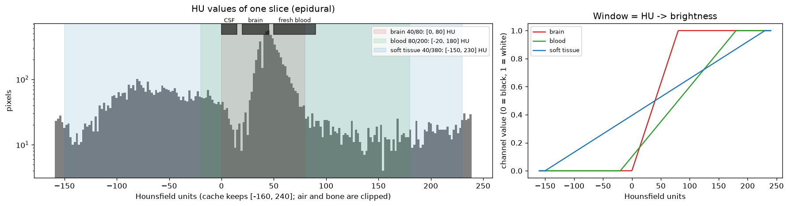
</p>
<p align="center"><sub><b>Figure 4.</b> HU histogram of one slice with the three window ranges (left) and how each window maps HU to brightness (right).</sub></p>

### 3.4 2.5D input

Only the first 16 KB of each DICOM is read to get `PatientID`, `SeriesInstanceUID` and `ImagePositionPatient[2]` (z). Whole series are
shuffled and added until `N_SLICES` is reached, slices are sorted by z, and every sample is the **(previous, current, next)** slice ×
3 windows = **9 channels** (edge slices repeat themselves). `timm` adapts the pretrained first convolution to 9 channels.

| | brain 40/80 | blood 80/200 | soft tissue 40/380 |
|---|:---:|:---:|:---:|
| **previous slice** | ch 1 | ch 2 | ch 3 |
| **current slice** | ch 4 | ch 5 | ch 6 |
| **next slice** | ch 7 | ch 8 | ch 9 |

<p align="center">
  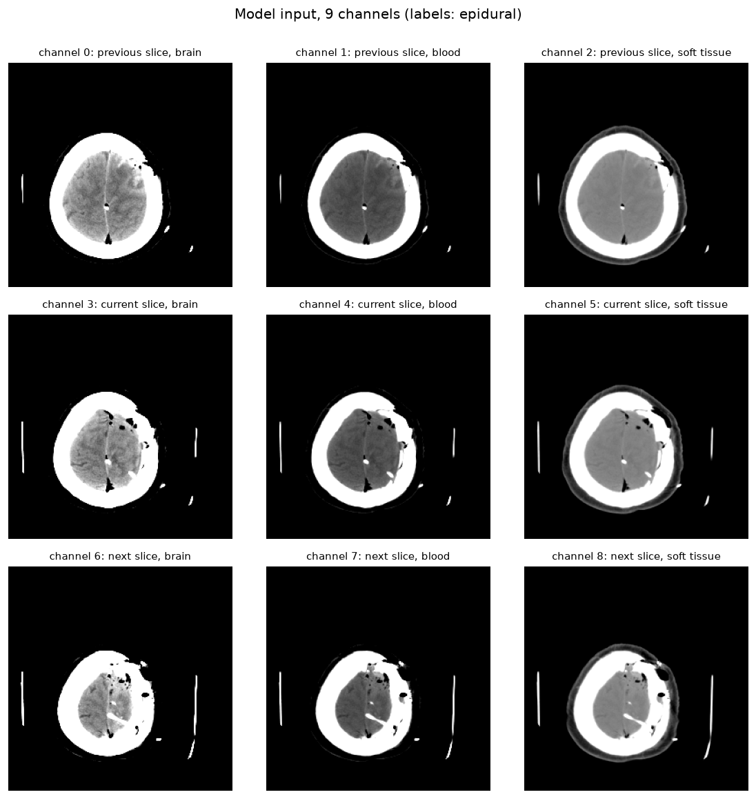
</p>
<p align="center"><sub><b>Figure 5.</b> The 9 input channels of one sample: rows = previous / current / next slice, columns = brain / blood / soft-tissue window.</sub></p>

**Augmentation** (training only, identical for the three slices): random horizontal flip and a small random affine (±10° rotation,
±5% shift, 0.9–1.1 scale), run on the GPU.

<p align="center">
  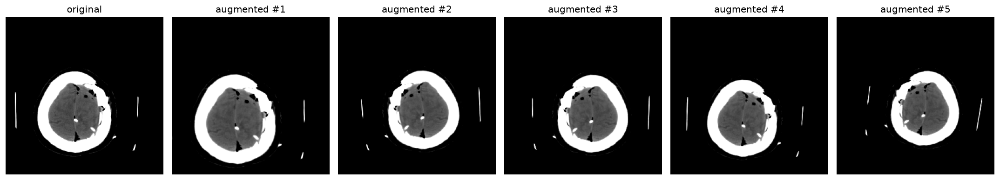
</p>
<p align="center"><sub><b>Figure 6.</b> One slice (blood window) and five random augmentations.</sub></p>

### 3.5 Stage 1: slice CNN

- `timm.create_model("tf_efficientnet_b2.ns_jft_in1k", in_chans=9, num_classes=0)` → dropout → `Linear(1408, 6)`; **7.7 M parameters**.
- `BCEWithLogitsLoss` with class weights `[1, 1, 1, 1, 1, 2]` (`any` counts double, exactly as in the competition metric).
- AdamW (lr 4e-4, weight decay 1e-4), OneCycleLR, mixed precision (AMP), batch 48, 256 × 256 px, 5 epochs.
- The checkpoint with the best validation weighted log loss is kept; validation and test use **horizontal-flip TTA**.

### 3.6 Stage 2: series GRU

A 2-layer **bidirectional GRU** reads the CNN's pooled features plus its 6 logits for every slice of a series (in z order) and adds a
correction to each slice's logits. The output layer starts at zero, so training starts from the CNN's own predictions. It is trained
with patient-grouped **5-fold CV on the validation series** (whose CNN features are out-of-sample), and the out-of-fold score decides
whether the submission uses it.

### 3.7 Metric

The competition metric is a **weighted multi-label log loss** over the six outputs, with `any` weighted 2 and each subtype weighted 1.
Lower is better. The notebook reports it on validation next to per-output log loss and AUC.

## 4. Experimental setup

| | Local run (figures in this README) | Earlier Kaggle run |
|---|---|---|
| Hardware | NVIDIA **RTX 4060 Laptop** (8 GB), 16 CPU threads | **Tesla T4** (one of T4 x2 used), 4 CPUs |
| Software | Python 3.12.9, torch 2.11.0+cu128, timm 1.0.31, pydicom 3.0.2 | Kaggle image, torch 2.11, CUDA 13 |
| Data source | extracted DICOMs in `Notebook/data/rsna/` | competition data mounted under `/kaggle/input` |
| Peak GPU memory (batch 48) | 4.3 GB | – |
| Training subset | 149,976 slices · 4,337 series · 4,183 patients (19.7 GB HU cache) | same |
| Train / validation | 119,975 slices (3,346 patients) / 30,001 slices (837 patients) | same |
| Seed | 42 | 42 |

**Run time of the local run** (training headers loaded from a previously saved `train_headers.csv`):

| Step | Time |
|---|---:|
| Cache 149,976 slices as HU int16 | 3.8 min |
| One training epoch (2,499 batches) + validation | ≈ 7.9 min |
| 5 epochs | ≈ 39 min |
| GRU, 5 folds | ≈ 2 min |
| Test header scan (121,232 headers at ~2,380 / s) | 51 s |
| Test inference, 3,518 series with flip TTA | 14.1 min |
| **Whole notebook** | **≈ 62 min** |

On Kaggle the same notebook took about 7.5 h, mostly because the training header scan alone needs **≈ 5.3 h** there (≈ 40 headers/s).

## 5. Results

### 5.1 Main result: validation set (patient-level split, best epoch, flip TTA)

| Output | Val positives | Baseline log loss* | **CNN log loss** | **CNN AUC** | GRU log loss (OOF) | GRU AUC (OOF) |
|---|---:|---:|---:|---:|---:|---:|
| epidural | 123 | 0.0267 | **0.0217** | **0.9366** | 0.0317 | 0.8672 |
| intraparenchymal | 1,503 | 0.1991 | **0.0678** | 0.9790 | 0.0818 | **0.9799** |
| intraventricular | 1,059 | 0.1528 | **0.0418** | **0.9899** | 0.0521 | 0.9871 |
| subarachnoid | 1,492 | 0.1977 | **0.1020** | **0.9460** | 0.1288 | 0.9447 |
| subdural | 2,043 | 0.2490 | **0.1279** | **0.9455** | 0.1728 | 0.9400 |
| **any** | 4,566 | 0.4270 | **0.1589** | 0.9641 | 0.2118 | **0.9655** |
| **Weighted log loss** | | | **0.0970** | | 0.1273 | |

<sub>*Baseline = always predicting that output's training-set prevalence. OOF = out-of-fold. Source: `Notebook/work/val_report.csv`.</sub>

- The CNN beats the baseline on **every** output; on `any` it cuts the log loss from 0.427 to 0.159 (−63%).
- The GRU had slightly higher AUC on `any` and intraparenchymal, but **worse log loss everywhere**, so the notebook automatically
  submitted the **CNN alone**.

<p align="center">
  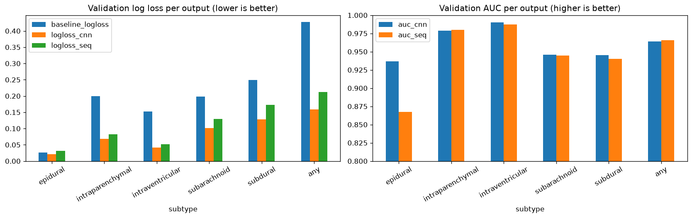
</p>
<p align="center"><sub><b>Figure 7.</b> Validation log loss (left, lower is better) and AUC (right, higher is better) per output.</sub></p>

### 5.2 Training dynamics

| Epoch | Train loss (weighted BCE) | Val weighted log loss | Val AUC (any) | Time |
|---:|---:|---:|---:|---:|
| 1 | 0.0962 | 0.1118 | 0.9477 | 490 s |
| 2 | 0.1055 | 0.1046 | 0.9611 | 470 s |
| **3** | 0.0579 | **0.1008** | **0.9622** | 469 s |
| 4 | 0.0439 | 0.1128 | 0.9570 | 472 s |
| 5 | 0.0484 | 0.1221 | 0.9561 | 471 s |

<sub>Validation in this table is without TTA; 0.1008 → 0.0970 with flip TTA. Source: `Notebook/work/history.csv`.</sub>

<p align="center">
  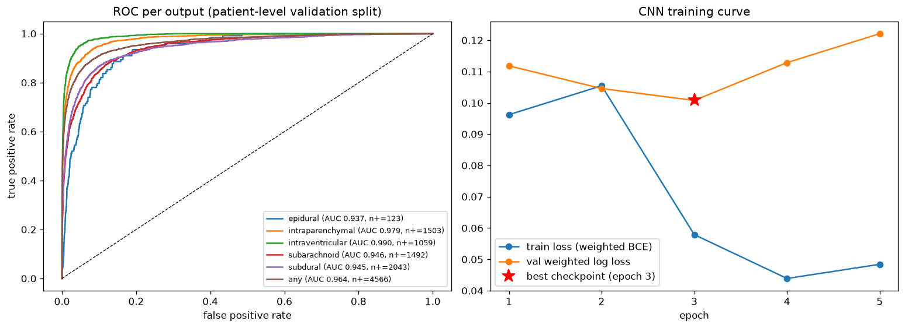
</p>
<p align="center"><sub><b>Figure 8.</b> ROC per output (left) and the training curve (right). Validation loss is lowest at epoch 3 and rises afterwards: the model overfits.</sub></p>

### 5.3 Calibration

Log loss punishes confident mistakes, so the probabilities have to mean what they say.

<p align="center">
  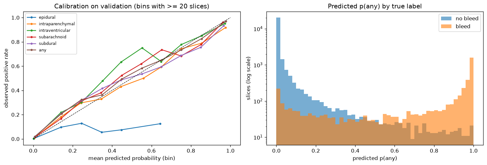
</p>
<p align="center"><sub><b>Figure 9.</b> Reliability curves (left; on the diagonal = well calibrated) and predicted p(any) for normal vs bleeding slices (right).</sub></p>

Five outputs lie close to the diagonal. **Epidural is badly over-confident**: slices predicted at p ≈ 0.6 are positive only ≈ 12% of the
time, which fits its low AUC and the very few training positives.

### 5.4 Reproducibility across hardware

The same notebook, split and seed were run twice:

| Run | Weighted log loss (CNN) | AUC (any) | GRU OOF log loss | Best epoch |
|---|---:|---:|---:|---:|
| Kaggle, Tesla T4 | **0.0933** | 0.9678 | 0.1174 | 3 |
| Local, RTX 4060 Laptop | 0.0970 | 0.9641 | 0.1273 | 3 |

Both runs pick epoch 3, both reject the GRU, and the scores differ by 0.004, which is within what GPU non-determinism and
data-loader ordering can cause.

### 5.5 Test set (stage 2)

121,232 test slices in 3,518 series were predicted. **12.1%** of them have p(any) > 0.5 (training prevalence: 14.3%), and the
predicted positive rate (p > 0.5) is below the training prevalence for every output, most clearly for subarachnoid
(2.4% vs 4.7%) and epidural, so the model is conservative on the subtle subtypes. The four highest-scoring test slices
are all large intraparenchymal bleeds, two of them with a subdural component.

<p align="center">
  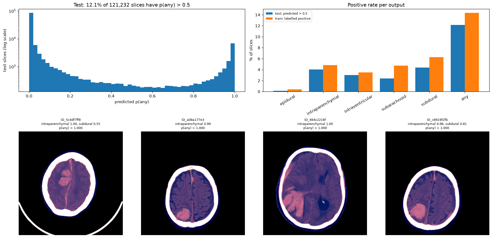
</p>
<p align="center"><sub><b>Figure 10.</b> Test-set p(any) distribution (log scale), predicted vs. training positive rate per output, and the four test slices with the highest p(any).</sub></p>

### 5.6 Official Kaggle score

`submission.csv` from the local run (CNN only) was submitted as a late submission on 19 Nov 2026 (submission ref. 58552335):

| Leaderboard | Weighted log loss ↓ |
|---|---:|
| **Private** (stage-2 test set) | **0.08346** |
| Public | 0.78814 |

The **private score is the meaningful one**, and it agrees with the validation score (0.0970): the patient-level validation split
was a fair estimate of performance on unseen patients. The public score is not comparable for late submissions to this competition:
its public split appears to be scored on images whose labels were later released as stage-2 training data, so late
submissions routinely show an unrelated public score.

## 6. Qualitative analysis

### 6.1 Hits, false alarms and missed bleeds

<p align="center">
  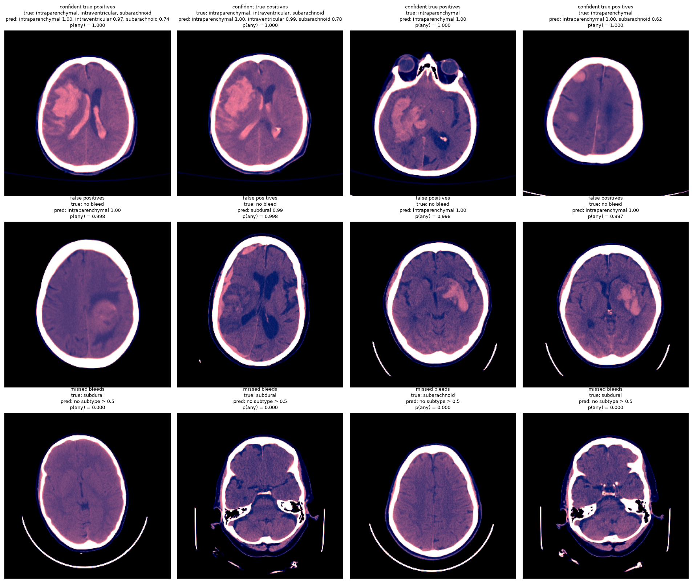
</p>
<p align="center"><sub><b>Figure 11.</b> Top: bleeding slices the model is most sure about. Middle: normal slices with the highest p(any) (false alarms). Bottom: bleeding slices with the lowest p(any) (missed bleeds).</sub></p>

### 6.2 Where the model looks (Grad-CAM)

<p align="center">
  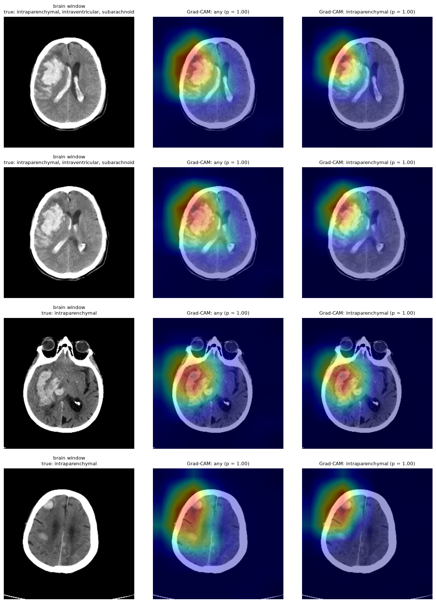
</p>
<p align="center"><sub><b>Figure 12.</b> Grad-CAM for <code>any</code> and the top subtype. The feature map is 1/32 of the input, so the maps are coarse, but they show whether the model attends to the bleed or to something else.</sub></p>

### 6.3 CNN vs. CNN + GRU along a series

<p align="center">
  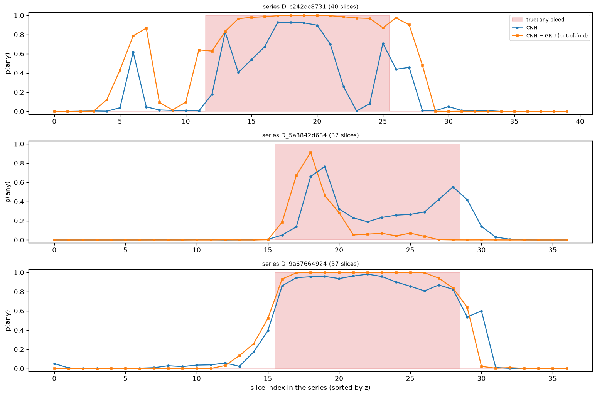
</p>
<p align="center"><sub><b>Figure 13.</b> p(any) slice by slice for three validation series that contain a bleed (red band = true label). The GRU curve is out-of-fold.</sub></p>

The GRU fills gaps inside a bleed (top and bottom series) but also spreads probability onto normal neighbours (top, slices 4–11 and
26–28) and can cut a real bleed short (middle). That is the pattern behind its higher AUC on `any` but worse log loss.

## 7. Discussion

- **2.5D context and windowing pay off.** Intraventricular (AUC 0.990) and intraparenchymal (0.979) bleeds, which are large and
  high-contrast, are found almost perfectly.
- **Subarachnoid and subdural are the hardest common subtypes** (AUC ≈ 0.945). Both are thin and lie next to bone or sulci, where the
  256 px down-sampling loses detail.
- **Epidural is rare** (123 validation positives), so its metrics are noisy, and the GRU in particular could not learn it from 692 series
  per fold (AUC 0.867).
- **Overfitting after epoch 3.** Training loss keeps falling while validation loss rises, so more data (the notebook uses 20% of the
  available slices) or stronger regularisation should help more than more epochs.
- **Why the GRU lost.** It only sees the 865 validation series. To work, it needs out-of-fold CNN features for the training series as
  well, which requires K-fold CNN training.

## 8. Problems I hit and how I fixed them

<details open>
<summary><b>1. <code>nn.DataParallel</code> crashed on Kaggle's T4 x2 (<code>CUDNN_STATUS_EXECUTION_FAILED_CUDART</code>)</b></summary>

- **Symptom:** with torch 2.11 / CUDA 13 the second GPU replica crashed inside cuDNN's batch norm, and a CUDA error like that leaves the
  kernel unusable.
- **Fix:** before training, the notebook tests four settings, **each in its own Python subprocess** so a crash cannot kill the kernel:
  channels-last vs. NCHW memory layout × cuDNN batch norm vs. PyTorch's native batch-norm kernel
  (`torch.batch_norm(..., cudnn_enabled=False)`; convolutions still use cuDNN). The first one that trains cleanly is used; if none does,
  training falls back to one GPU and the errors go to `dp_test_errors.log`.
- **Finding:** on the T4 x2 only **NCHW + native batch norm** worked; both channels-last settings failed (cuDNN *"unable to find an
  engine"* / *"misaligned address"*).
</details>

<details>
<summary><b>2. The training header scan took over 5 hours on Kaggle</b></summary>

- **Cause:** 752,802 DICOMs on Kaggle's latency-bound input disk, ≈ 40 headers/s.
- **Fix:** read only the first **16 KB** of each file with `stop_before_pixels`, use 128 I/O threads on Kaggle, and save
  `train_headers.csv` / `test_headers.csv`. Add the run's output as an input dataset and the notebook finds and reuses them
  automatically. Locally the same scan runs at ≈ 2,400 headers/s.
</details>

<details>
<summary><b>3. A Kaggle session died after ~6.5 hours</b></summary>

- **Cause:** an interactive session hit its idle limit while the long header scan and training were running.
- **Fix:** run long jobs with **Save Version → Save & Run All (Commit)**, which runs in the background and keeps the output files,
  and attach the previous output so the header scan is skipped. The config also caps training (`TRAIN_HOURS`) and keeps
  `RESERVE_HOURS` free so evaluation and test inference finish inside Kaggle's 12 h limit.
</details>

<details>
<summary><b>4. DataLoader workers failed on Windows</b></summary>

- **Cause:** Windows *spawns* worker processes instead of forking, and a spawned worker can only load classes from an importable file,
  not ones defined in a notebook cell.
- **Fix:** the `SliceDS` dataset is written to a small module file and imported from there; Windows uses 4 loader workers.
</details>

<details>
<summary><b>5. The dataset is huge (~180 GB zip, ~450 GB extracted)</b></summary>

- **Fix:** locally the notebook can read DICOMs **straight from the competition zip**, so nothing has to be extracted (it uses the
  extracted folders when they exist, as in this run). The Kaggle API key stays in `~/.kaggle`, never in the notebook.
  On Kaggle the data is already mounted, so `kagglehub.competition_download(...)` must **not** be called there.
</details>

<details>
<summary><b>6. Disk and RAM for the image cache</b></summary>

- **Fix:** cache **clipped HU as int16** (exact, half the size of a 3-window uint8 cache) and stream it to a `.npy` file read back with
  `np.load(..., mmap_mode="r")`. 150k slices at 256 px = 19.7 GB. `N_SLICES` is capped by the free space in the temp folder.
</details>

<details>
<summary><b>7. Bad DICOMs and label rows</b></summary>

- 24 duplicated *(image, subtype)* label rows → `drop_duplicates` before pivoting.
- A corrupt training DICOM (`ID_6431af929`) → removed.
- Scans with a wrong 12-bit intercept (> −100) → pixel values shifted back into range before the HU conversion.
- Unreadable slices are tracked and never used for training (0 in this run).
</details>

<details>
<summary><b>8. CUDA errors killed the kernel without a message</b></summary>

- **Fix:** a **GPU preflight** runs one real batch before training (it reported loss 0.8056 and 4.3 GB peak memory in this run), so
  out-of-memory or kernel errors show their message instead of silently restarting the kernel. On an 8 GB GPU, batch 24–32 is the
  fallback if 48 does not fit.
</details>

<details>
<summary><b>9. Overfitting and a second stage that did not help</b></summary>

- The best-epoch checkpoint (epoch 3) is kept instead of the last one.
- The GRU is used for the submission **only if** its out-of-fold weighted log loss beats the CNN; in both runs it did not, so the
  CNN alone was submitted.
</details>

<details>
<summary><b>10. Accuracy looked great but meant nothing</b></summary>

- With 85.7% normal slices, accuracy rewards a model that never finds a bleed. The project reports per-output **log loss and AUC next
  to a prevalence baseline**, and uses a patient-level split (an `assert` stops the notebook if any patient is in both sets) so the
  validation numbers are not inflated by near-duplicate slices of the same person.
</details>

## 9. Reproducing the results

### Option A: Kaggle

1. Open the [competition page](https://www.kaggle.com/competitions/rsna-intracranial-hemorrhage-detection), click **Join Competition**
   and accept the rules (otherwise the data will not attach).
2. On the competition's **Code** tab, click **New Notebook → File → Import Notebook** and upload
   [`Notebook/brain-bleed-rsna-azmi-kaggle.ipynb`](Notebook/brain-bleed-rsna-azmi-kaggle.ipynb).
3. Settings panel: **Accelerator = GPU T4 x2**, **Internet = On** (downloads the pretrained `timm` weights once; needs a phone-verified account).
4. Check that the competition data appears under **Input**. The notebook searches `/kaggle/input` for `stage_2_train.csv`, or set `RSNA_DIR`.
5. **Save Version → Save & Run All (Commit)**. Everything needed (`pydicom`, `timm`, `torch`, `opencv-python`, `scikit-learn`, …) is
   preinstalled; the first cell pip-installs `pydicom` and `timm` if they are missing.

### Option B: local GPU (how the results above were produced)

```bash
python -m venv .venv
```

```bash
.venv\Scripts\activate
```

```bash
pip install torch torchvision --index-url https://download.pytorch.org/whl/cu128
```

```bash
pip install timm pydicom opencv-python numpy pandas scikit-learn matplotlib tqdm kaggle jupyter ipykernel
```

Then put the data in `Notebook/data/rsna/` (either the extracted `stage_2_train/`, `stage_2_test/` and CSVs, or the competition zip),
open the notebook in VS Code or Jupyter **from the `Notebook/` folder**, select the `.venv` kernel and **Run All**.
If the data is missing and `AUTO_DOWNLOAD = True`, the notebook downloads the zip with the `kaggle` CLI, using the API key in
`~/.kaggle/kaggle.json`. Outputs go to `Notebook/work/` and figures to `assets/`.

For a quick smoke test, override the config through an environment variable before starting Jupyter, for example
`RSNA_CFG='{"N_SLICES": 3000, "EPOCHS": 1}'`.

### Trained weights (access on request)

The trained model is on Hugging Face as a **gated** model:
**[azizulabedinazmi/rsna-ich-efficientnet-b2-2.5d](https://huggingface.co/azizulabedinazmi/rsna-ich-efficientnet-b2-2.5d)**.
Downloads need my approval.

**How to get access**
1. Sign in to Hugging Face and open the model page.
2. Click **Request access** and fill in the short form (name, affiliation, intended use), confirming that you have joined the
   RSNA competition on Kaggle and will use the weights for non-commercial, non-clinical purposes only.
3. I review each request manually. Once approved, the files can be downloaded with `hf download` or `hf_hub_download`.

| File | Content |
|---|---|
| `best_cnn.pt` | CNN `state_dict`, best epoch (3), the model behind the 0.08346 private score |
| `seq_gru_fold0-4.pt` | Bidirectional GRU, 5 folds (not used for the submission) |
| `history.csv`, `val_report.csv` | Training log and per-output validation metrics |
| `inference_example.py` | Self-contained loading and prediction example |

```python
from huggingface_hub import hf_hub_download
path = hf_hub_download("azizulabedinazmi/rsna-ich-efficientnet-b2-2.5d", "best_cnn.pt")   # after access is approved
```

The weights are licensed **CC BY-NC 4.0** (non-commercial), because the training data may be used for non-commercial purposes only.
The notebook in this repository still trains the CNN itself; `best_cnn.pt` is for inference or fine-tuning in your own code.

## 10. Submitting to the Kaggle competition

The competition closed in 2019, but Kaggle still accepts **late submissions**: they get a public and a private score but do not
appear on the leaderboard. The score is the same weighted log loss as above (lower is better).

**File format** (`submission.csv`, 727,392 rows + header = 121,232 test slices × 6 outputs):

```text
ID,Label
ID_0fbf6a978_epidural,0.014497915
ID_0fbf6a978_intraparenchymal,0.080920875
...
ID_0fbf6a978_any,0.32781
```

### Way 1: from your laptop with the Kaggle CLI (the local run already wrote the file)

1. Join the competition on the website and accept the rules (once).
2. Make sure your API token is set up (`~/.kaggle/kaggle.json`, from *Kaggle → Settings → API → Create New Token*).
3. From the project folder:

```bash
kaggle competitions submit rsna-intracranial-hemorrhage-detection -f "Notebook/work/submission.csv" -m "EfficientNet-B2 2.5D, 150k slices, local RTX 4060" --wait
```

4. Check the score:

```bash
kaggle competitions submissions rsna-intracranial-hemorrhage-detection
```

### Way 2: upload in the browser

Competition page → **Submit Prediction** (or **Late Submission**) → drag in `Notebook/work/submission.csv` (≈ 26 MB; zipping it first
makes the upload faster) → add a description → **Submit**. The score appears under **My Submissions** after a few minutes.

### Way 3: from a Kaggle notebook

Keep `MAKE_SUBMISSION = True`, run **Save Version → Save & Run All (Commit)**, then open the finished version → **Output** tab →
select `submission.csv` → **Submit**.

## 11. Configuration

All settings are in the `CFG` dictionary in the first code cell:

| Key | Default | Meaning |
|---|---|---|
| `N_SLICES` | `150_000` | Training slices; whole series are added until this is reached |
| `IMG_SIZE` | `256` | Slices are resized from 512 × 512 |
| `BACKBONE` | `tf_efficientnet_b2.ns_jft_in1k` | Any `timm` model name |
| `CONTEXT` | `True` | (prev, cur, next) → 9 channels; `False` = single slice, 3 channels |
| `VAL_FRAC` | `0.2` | Fraction of **patients** held out (also the GRU's training set) |
| `EPOCHS` / `BATCH` / `LR` | `5` / `48` / `4e-4` | OneCycle schedule, AdamW |
| `MULTI_GPU` | `True` | `DataParallel` if a setting passes the subprocess test |
| `TRAIN_HOURS` / `SESSION_HOURS` / `RESERVE_HOURS` | `4` / `12` (Kaggle) / `2.5` | Time budget so the run fits in Kaggle's 12 h limit |
| `SEQ_MODEL`, `SEQ_FOLDS`, `SEQ_EPOCHS` | `True`, `5`, `25` | GRU over each series, patient-grouped K-fold |
| `TRAIN_HEADERS_CSV` / `TEST_HEADERS_CSV` | `None` | Saved header scans; `None` = search automatically |
| `AUTO_DOWNLOAD` | `True` | Local only: download the competition zip if missing |
| `MAKE_SUBMISSION` | `True` | Predict the stage-2 test set and write `submission.csv` |

Environment variables: `RSNA_DIR` (data folder), `RSNA_WORK` (outputs), `RSNA_TMP` (cache), `RSNA_ASSETS` (figures), `RSNA_CFG` (JSON overrides).
There are no secrets in the project.

## 12. Project structure

```text
Brain Bleed Detection on CT/
├── Notebook/
│   ├── brain-bleed-rsna-azmi-kaggle.ipynb   # the whole pipeline, with the outputs of the local run
│   ├── data/rsna/                           # RSNA data (not in the repo)
│   └── work/                                # run outputs (not in the repo)
│       ├── best_cnn.pt                      # best CNN checkpoint (epoch 3)
│       ├── seq_gru_fold0-4.pt               # GRU folds
│       ├── history.csv                      # per-epoch training log
│       ├── val_report.csv                   # per-output validation metrics
│       ├── train_headers.csv / test_headers.csv / subset_meta.csv
│       └── submission.csv                   # competition submission
├── assets/                                  # 14 figures written by the notebook
├── CITATION.cff                             # "Cite this repository" metadata
├── LICENSE                                  # MIT, for the code and notebook
├── LICENSE-docs                             # CC BY 4.0 + attribution notice, for docs and figures
└── README.md
```

## 13. Limitations and future work

**Limitations**
- Trained on ~20% of the slices (150k of 753k) for 5 epochs at 256 px, so it is well behind the competition's top scores.
- The GRU only sees the validation series and did not help.
- Epidural has only 123 validation positives, so its metrics have wide uncertainty.
- Single-split validation; no confidence intervals yet.
- **This is a research and learning project, not a validated medical device. It must not be used for diagnosis.**

**Future work** (proposed, not implemented)
- Train on all 753k slices and with K-fold CNNs, which also gives out-of-fold features to train the GRU on the training series.
- Larger inputs (384–512 px) and other backbones (e.g. ConvNeXt); cache size grows with `IMG_SIZE²`.
- Record the two-GPU speed-up on T4 x2 with the working NCHW + native batch-norm setting.
- A separate inference notebook that loads saved weights, so a submission does not need retraining.

## 14. Citation

If you use this work, please credit it (see [License](#15-license)). GitHub's **"Cite this repository"** button (from
[`CITATION.cff`](CITATION.cff)) gives the same citation in APA and BibTeX.

```bibtex
@misc{azmi2026brainbleed,
  author = {Azizul Abedin Azmi},
  title  = {Brain Bleed Detection on CT: 2.5D EfficientNet-B2 and BiGRU for Intracranial Hemorrhage Detection},
  year   = {2026},
  howpublished = {\url{https://github.com/azizulabedinazmi/Brain-Bleed-Detection-on-CT}},
  note   = {ORCID: 0009-0003-5269-6900. Code: MIT License; documentation and figures: CC BY 4.0}
}

@misc{azmi2026brainbleedweights,
  author = {Azizul Abedin Azmi},
  title  = {RSNA ICH EfficientNet-B2 2.5D},
  year   = {2026},
  publisher = {Hugging Face},
  howpublished = {\url{https://huggingface.co/azizulabedinazmi/rsna-ich-efficientnet-b2-2.5d}},
  note   = {Trained weights for Brain Bleed Detection on CT. ORCID: 0009-0003-5269-6900. License: CC BY-NC 4.0}
}
```

Dataset: Flanders A. E. et al., *Construction of a Machine Learning Dataset through Collaboration: The RSNA 2019 Brain CT Hemorrhage
Challenge*, Radiology: Artificial Intelligence, 2020.

## 15. License

| Part | License | What you must do |
|---|---|---|
| **Code and notebook** | [MIT](LICENSE) | Keep the copyright notice *"Copyright (c) 2026 Azizul Abedin Azmi"* and the license text in every copy |
| **Documentation and figures** | [CC BY 4.0](LICENSE-docs) | Give appropriate credit, link to the license, and indicate if changes were made |

Both allow use for any purpose, including commercial use. The code uses MIT because the competition rules require publicly shared
competition code to be under an OSI-approved license that does not limit commercial use (CC licenses are not OSI-approved for code).

For the documentation and figures, the credit must include the name **"Azizul Abedin Azmi"** (or the logo provided in the official
repository). Example:

> "Brain Bleed Detection on CT" by Azizul Abedin Azmi, licensed under [CC BY 4.0](https://creativecommons.org/licenses/by/4.0/). Changes were made.

**Data:** the RSNA dataset is **not** covered by either license. Under the competition rules it may be used for non-commercial
purposes only and may not be copied, redistributed or re-identified. This repository contains no DICOM files. Several figures
(`output.png`, `series_labels.png`, `context_input.png`, `augmentation.png`, `val_predictions.png`, `gradcam.png`,
`test_predictions.png`) show example CT slices from the dataset for illustration only.

**Weights:** [CC BY-NC 4.0](https://creativecommons.org/licenses/by-nc/4.0/), distributed on request through Hugging Face
(see [Trained weights](#trained-weights-access-on-request)).

## 16. Portfolio project and disclaimer

- **Purpose.** This is a personal portfolio and learning project by Azizul Abedin Azmi. It documents my own work on the RSNA
  Intracranial Hemorrhage Detection dataset; it is not a commercial product or service.
- **Competition status.** I joined the competition on Kaggle and accepted its rules. The submission was made in November 2026 as a
  **late submission**, after the competition closed in November 2019; it is scored but not ranked and is not eligible for prizes.
- **No affiliation.** This project is not affiliated with, sponsored or endorsed by the Radiological Society of North America (RSNA),
  Kaggle, or any of the institutions that contributed data.
- **Data.** The RSNA data is not redistributed here: no DICOM files, labels or header files are included, and the trained weights are
  shared only on request with people who confirm they have accepted the competition rules. The example CT figures are included for
  illustration only.
- **Not for clinical use.** The model has not been clinically validated. It must not be used for diagnosis, triage or any decision
  about a patient. All results are research results on one dataset.
- **No warranty.** Everything here is provided "as is", without warranty of any kind (see [LICENSE](LICENSE)).
- **Takedown requests.** If you are a rights holder and want any material removed, please
  [open an issue](https://github.com/azizulabedinazmi/Brain-Bleed-Detection-on-CT/issues) and it will be removed promptly.

---

<div align="center">
<sub>Made by <b>Azizul Abedin Azmi</b> · <a href="https://orcid.org/0009-0003-5269-6900">ORCID 0009-0003-5269-6900</a></sub>
</div>
